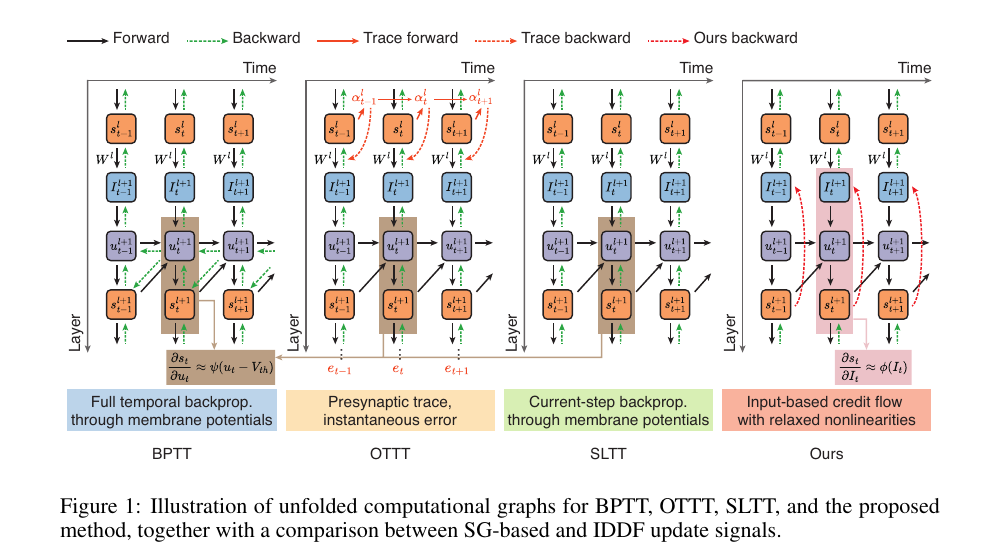

<div align="center">

# Efficient Training of Deep Spiking Neural Networks with Input-Driven Derivative-Free Updates

[](https://neurips.cc/Conferences/2026)
[](https://www.python.org/)
[](https://pytorch.org/)
[](https://snntorch.readthedocs.io/)
[](LICENSE)

**Official implementation of IDDFT, accepted at NeurIPS 2026.**

Yongbo Zhang<sup>1,*</sup> · Xinzhe Li<sup>1</sup> · Katsuma Inoue<sup>1</sup> ·
Mitsumasa Nakajima<sup>2</sup> · Toshikazu Hashimoto<sup>2</sup> ·
Yasuo Kuniyoshi<sup>1</sup> · Kohei Nakajima<sup>1</sup>

<sup>1</sup>The University of Tokyo &nbsp;&nbsp; <sup>2</sup>NTT Device Technology Labs.  
<sup>*</sup>Corresponding author: [zhang@isi.imi.i.u-tokyo.ac.jp](mailto:zhang@isi.imi.i.u-tokyo.ac.jp)

</div>

<p align="center">
  
</p>

## Overview

Input-Driven Derivative-Free Training (**IDDFT**) trains deep spiking neural networks without constructing local update signals from membrane-potential-based surrogate gradients (SG). Instead, it applies a relaxed nonlinearity directly to the current input drive:

$
\Delta W_{\mathrm{IDDFT}}^{l-1}
=-\eta\sum_{t=1}^{T}
\left[e_t^l\odot\phi(I_t^l)\right](s_t^{l-1})^{\top}.
$

This formulation preserves the original forward neuronal dynamics while removing temporal error propagation through historical membrane states. IDDFT can be combined with standard backpropagation (**BP-IDDFT**) or uniform sign-concordant feedback (**uSF-IDDFT**).

### Highlights

- **Input-driven and derivative-free:** local update signals use the input drive rather than membrane-potential-based surrogate derivatives.
- **No temporal error backpropagation:** the backward process does not propagate errors through historical membrane states.
- **Memory efficient:** BP-IDDFT reduces peak training memory by approximately **67%** relative to BPTT-SG in the reported ResNet-19 experiments.
- **Flexible nonlinearities:** relaxed nonlinear factors do not need to approximate the spike derivative point by point.
- **Competitive performance:** uSF-IDDFT achieves strong results on static and event-based vision benchmarks.
- **Adversarial robustness:** the repository includes transfer-attack evaluation with FGSM, RFGSM, and PGD.

## Main Results

| Dataset | Architecture | Timesteps | Accuracy |
|:--|:--|--:|--:|
| CIFAR-10 | ResNet-19 | 4 | **96.71 ± 0.09%** |
| CIFAR-100 | ResNet-19 | 4 | **78.88 ± 0.13%** |
| CIFAR10-DVS | VGGSNN | 10 | **83.88 ± 0.60%** |
| Tiny-ImageNet | ResNet-19 | 4 | **62.70 ± 0.39%** |

The benchmark results use uSF-IDDFT with standard LIF neurons and cross-entropy loss. Each result is reported over five independent trials.

## Repository Structure

```text
.
├── CIFAR10/                 # ResNet-19 training on CIFAR-10
├── CIFAR100/                # ResNet-19 training on CIFAR-100
├── CIFAR10-DVS/             # CIFAR10-DVS preprocessing and VGGSNN training
├── Tiny-Imagenet/           # Tiny-ImageNet preparation and distributed training
├── Adversarial_attack/      # FGSM, RFGSM, and PGD transfer attacks
├── Efficient_train.py       # BPTT-SG vs. memory-efficient BP-IDDFT
├── requirements.txt         # Python dependencies
├── LICENSE                  # MIT License
└── README.md
```

## Installation

The experiments were conducted with:

```text
Python       3.11.13
PyTorch      2.9.1
CUDA         12.8
cuDNN        9.10.2
snnTorch     0.9.4
```

Create an environment and install PyTorch/torchvision for your CUDA version, followed by the remaining dependencies:

```bash
conda create -n iddft python=3.11.13 -y
conda activate iddft

# Install PyTorch and torchvision using the command appropriate for your CUDA version:
# https://pytorch.org/get-started/locally/

pip install -r requirements.txt
```

BioTorch is installed as an external dependency. To install the core dependencies directly:

```bash
pip install biotorch==0.0.16 snntorch==0.9.4 numpy matplotlib pillow tqdm
```

## Configuration

### Method names used by the scripts

| Script argument | Method in the paper | Spatial feedback | Local nonlinear factor |
|:--|:--|:--|:--|
| `BP` | BPTT-SG | exact transposed weights | membrane-potential SG |
| `uSF` | uSF-SG | sign-concordant feedback | membrane-potential SG |
| `auSF` | uSF-IDDFT | sign-concordant feedback | input-driven relaxed factor |
| `bp_iddft` | BP-IDDFT (`Efficient_train.py`) | exact transposed weights | input-driven relaxed factor |

> **Note:** The code identifier `auSF` is retained for compatibility with the experimental scripts and corresponds to **uSF-IDDFT** in the paper.

### Gaussian relaxed nonlinearity

The benchmark experiments instantiate the relaxed factor as

$$
\phi(I)=\exp\left[-\alpha(I+\theta)^2\right].
$$

| Dataset | `--amp` ($\alpha$) | `--phase` ($\theta$) |
|:--|--:|--:|
| CIFAR-10 | 3.0 | -1.5 |
| CIFAR-100 | 3.0 | -1.5 |
| CIFAR10-DVS | 2.5 | -1.0 |
| Tiny-ImageNet | 3.0 | -1.5 |

## Data Preparation

Several scripts contain `...` placeholders for machine-specific dataset, checkpoint, and output paths. Replace these placeholders before running an experiment.

### CIFAR-10 and CIFAR-100

Set `log_root` in the corresponding `main.py`. The datasets are downloaded automatically by `torchvision` into:

```text
<log_root>/data/cifar
<log_root>/data/cifar_100
```

### CIFAR10-DVS

1. Download and extract the raw CIFAR10-DVS event files.
2. Set `raw_root` and `save_root` in `CIFAR10-DVS/preprocess_data.py`.
3. Generate 10-frame event tensors:

```bash
cd CIFAR10-DVS
python preprocess_data.py
```

4. Set `frames_root` in `CIFAR10-DVS/main.py` to the generated directory.

The preprocessing script stores compressed `.npz` files containing `frames` with shape `[T, 2, 128, 128]`. Training transforms resize the frames to `48 × 48`.

### Tiny-ImageNet

After extracting Tiny-ImageNet, set `root` in `Tiny-Imagenet/load_data.py` and reorganize the validation images into class directories:

```bash
cd Tiny-Imagenet
python load_data.py
```

Pass the dataset root, containing `train/` and `val/`, through `--data_path` when training.

## Training

Run commands from inside the corresponding experiment directory so that local model imports resolve correctly.

### CIFAR-10

```bash
cd CIFAR10
python main.py \
  --trial_num 1 \
  --lr 0.1 \
  --T_step 4 \
  --n_epochs 400 \
  --training_strategy auSF \
  --bfunc gaussian \
  --amp 3.0 \
  --phase -1.5 \
  --device cuda:0
```

### CIFAR-100

```bash
cd CIFAR100
python main.py \
  --trial_num 1 \
  --lr 0.1 \
  --T_step 4 \
  --n_epochs 400 \
  --training_strategy auSF \
  --bfunc gaussian \
  --amp 3.0 \
  --phase -1.5 \
  --device cuda:0
```

### CIFAR10-DVS

```bash
cd CIFAR10-DVS
python main.py \
  --trial_num 1 \
  --lr 0.1 \
  --T_step 10 \
  --n_epochs 400 \
  --training_strategy auSF \
  --bfunc gaussian \
  --amp 2.5 \
  --phase -1.0 \
  --device cuda:0
```

### Tiny-ImageNet

The reported experiment used eight GPUs, a per-GPU batch size of 14, and a global batch size of 112:

```bash
cd Tiny-Imagenet
torchrun --standalone --nproc_per_node=8 main.py \
  --data_path /path/to/tiny-imagenet-200 \
  --trial_num 1 \
  --batch 14 \
  --lr 0.1 \
  --T_step 4 \
  --n_epochs 300 \
  --training_strategy auSF \
  --bfunc gaussian \
  --amp 3.0 \
  --phase -1.5
```

The supplied `run.sh` files execute five trials sequentially. Update the selected GPU in each script before use:

```bash
cd CIFAR10  # or CIFAR100 / CIFAR10-DVS
bash run.sh
```

The current dataset-specific training scripts write console logs through `run.sh`. To retain checkpoints and JSON summaries, configure `save_root` and enable the provided saving blocks in the corresponding `main.py`.

## Memory-Efficient BP-IDDFT

`Efficient_train.py` compares BPTT-SG with a memory-efficient BP-IDDFT implementation on CIFAR-10 and CIFAR-100:

```bash
python Efficient_train.py \
  --cifar10_root /path/to/cifar10 \
  --cifar100_root /path/to/cifar100 \
  --datasets cifar10 cifar100 \
  --methods bptt_sg bp_iddft \
  --n_epochs 100 \
  --batch 128 \
  --T_step 4 \
  --amp 3.0 \
  --phase -1.5 \
  --device cuda:0 \
  --save_root ./results/efficiency
```

The script reports peak allocated CUDA memory, epoch time, accuracy, and a global CSV summary. A CUDA-capable GPU is required.

## Adversarial Robustness Evaluation

The attack implementation supports:

- FGSM
- randomized FGSM (RFGSM)
- PGD with configurable iteration counts
- source-to-target transfer matrices across BPTT-SG, uSF-SG, and uSF-IDDFT models

Before evaluation, configure the dataset root, checkpoint paths in `get_model_path`, and result directory in the relevant `Adversarial_attack/main_*.py` file.

Example for CIFAR-10:

```bash
cd Adversarial_attack
python main_cifar10.py \
  --trial_num 1 \
  --attack all \
  --eps 0.031372549 \
  --alpha 0.01 \
  --steps 10 \
  --T_step 4 \
  --amp 3.0 \
  --phase -1.5 \
  --device cuda:0
```

Use `main_cifar100.py` and `main_dvs.py` for the other two datasets. To reproduce the PGD settings in the paper, evaluate `--steps 7`, `10`, `20`, and `40` separately.

## Reproducibility Notes

- Benchmark experiments use SGD with learning rate `0.1`, momentum `0.9`, weight decay `1e-4`, cosine annealing to `1e-6`, and label smoothing `0.1`.
- LIF neurons use $\beta=0.5$ and $V_{\mathrm{th}}=1.0$.
- CIFAR-10, CIFAR-100, and Tiny-ImageNet use direct encoding with four timesteps.
- CIFAR10-DVS uses ten accumulated event frames.
- `trial_num` controls random initialization and data-loader seeding.
- The main benchmark results report the mean and standard deviation over five independent trials.

## Citation

If this work is useful for your research, please cite:

```bibtex
@inproceedings{zhang2026iddft,
  title     = {Efficient Training of Deep Spiking Neural Networks with Input-Driven Derivative-Free Updates},
  author    = {Zhang, Yongbo and Li, Xinzhe and Inoue, Katsuma and Nakajima, Mitsumasa and Hashimoto, Toshikazu and Kuniyoshi, Yasuo and Nakajima, Kohei},
  booktitle = {Advances in Neural Information Processing Systems},
  year      = {2026}
}
```

## Acknowledgements

The SNN implementations use [PyTorch](https://pytorch.org/) and [snnTorch](https://snntorch.readthedocs.io/). The uSF components use [BioTorch](https://github.com/jsalbert/biotorch), which help us to quickly implement our codes.

## License

This project is released under the [MIT License](LICENSE).
